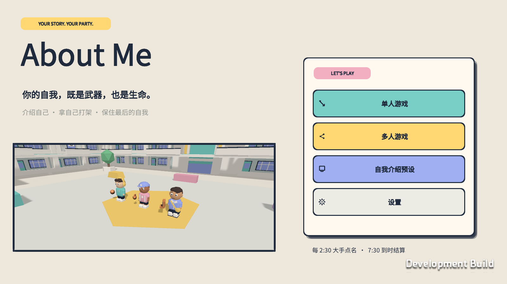

**本机最新整合：完整 R15。** 普通近战两次有效命中击飞掉落，重击／干扰／范围攻击一次有效命中掉落；攻击性路障与场地接触击倒。保留完整 R14 嘴型与短梗气泡。双击 `scripts/start-latest.command`，API／权威 8099／7799。详见 [R15 交付](docs/COMBAT_R15_DELIVERY.md)。

**公网当前仍为完整 R12。** R15 尚未部署公网。

# About Me

团结引擎 2022.3.62t11 / 3D Persona 派对对战原型。

**最新整合试玩入口：双击 `scripts/start-latest.command`。** 当前完整 `playtest-combat-r15`：近战每次60，重击与干扰一次命中掉落，喷火两次各60，攻击性场地踩中掉落；保留20 Persona、16 MBTI、277道具、四种动物与1–6人机。参见 [R15交付](docs/COMBAT_R15_DELIVERY.md)。

`builds/v4-mac/About Me.app`；直接打开后选择「单人游戏 → 使用练习道具开始」。需要独立多人服务时运行 `scripts/start-v4.command`（7794 / 8094 端口）。旧 V3 试玩包未覆盖。详见 [V4 实现与实测记录](docs/ACTIVE_RAGDOLL_V4.md)，以及 [动作对比视频](artifacts/characters-v4/v4-actions-comparison.mp4)。

这是可以编译运行的开发工程。**样例测试、真实 AI 生成、本机联机验证、异地联机验证是不同状态，请勿混用。** 验证结果与尚未完成的工作见 [开发状态](docs/STATUS.md)。

## 开始菜单与单人对战

打开游戏后显示 **About Me** 主菜单：单人游戏、多人游戏、自我介绍预设、设置。一个人体验直接选择「单人游戏 → 使用练习道具开始（非 AI）」即可；无需启动 API 或游戏服务器。NPC 使用同一套战斗规则，会追击、使用道具、抓取、吞噬、回收和沿楼梯追到二层。已有真实角色会缓存到本机，可离线用于单人局。

自我介绍预设支持多份草稿，切换草稿不会替换当前 Persona。只有点击生成并成功返回才替换当前资产。设置包含服务地址、镜头灵敏度、触控显示与减少动态效果。

标准对局为 5 秒展示后开始计时，2:30 和 5:00 大手点名，7:30 强制结算；只剩一名存活者可提前结束。到时在存活者中先比完成吞噬数，再比剩余 Persona，完全相同则并列获胜。地面和未吞噬完成的资产仍计入原主人剩余数。

详细测试与已知限制见 [菜单与 NPC 交付记录](docs/MENU_SOLO_DELIVERY.md)。



## 玩具贴纸派对 UI

完整流程使用统一的奶油纸张、深蓝粗描边、彩色贴纸、软阴影和轻量弹性动效。首页、连接设置、六人房、战斗 HUD、Persona 背包、横屏触控、二维码和结算均使用同一主题；所有形状与图标由小型运行时图集生成，不依赖第三方 UI 或动画插件。

界面以 1600×900 为桌面基准，通过安全区画布适配 16:9、19.5:9 和 4:3 横屏。横屏手机隐藏键盘提示，并启用独立的摇杆和分组动作按钮。竖屏不在当前范围内，微信真机安全区仍需取得 AppID 和设备后复验。

开发构建可以直接生成确定性的界面截图：

```sh
'builds/mac/About Me.app/Contents/MacOS/About Me' \
  --ui-preview home --capture-size 1600x900 \
  --capture "$PWD/artifacts/ui-home.png"
```

`--ui-preview` 支持 `home`、`home-expanded`（兼容别名）、`solo`、`multiplayer`、`presets`、`settings`、`lobby`、`qr`、`hud`、`bag`、`touch` 和 `results`。`home` 直接显示四个英文气泡入口；预览数据明确标注为 UI 预览，不连接服务器，也不写入正式结算。

## 打开和运行

**本机双客户端体验（已有构建）：**双击 `scripts/start-local.command`。脚本启动本机游戏服务、API 和网页服务，并打开 macOS 游戏与浏览器。两边先到「自我介绍预设」选择「本地样例（无需 AI）」，返回主菜单后进入「多人游戏」；一边创建房间，另一边输入该房间码加入；房间达到 2 人后房主即可开始，最多 6 人，Ready 仅作状态提示。保留终端，结束后按 Ctrl+C 停止服务。此流程不需要 AI 账号，使用明确标注的测试资产。

「自我介绍预设」页会显示“真实 AI 已连接 / 未配置 / 服务不可达”。“AI 生成 Persona”只调用真实模型；未配置 `server/.env` 时不会用固定内容冒充生成结果。此时请点击“本地样例（无需 AI）”测试房间和战斗。大学 Persona 会先搜索公开校徽候选，由 `deepseek-flash` Vision 核对校徽并给出保留完整轮廓的裁切范围，游戏中明确标记“DeepSeek 生成”。预设页的「上传自我介绍图片并识别」会自动将 JPEG、PNG、GIF 或 WebP（最大 10 MB）发送至服务端，以 `deepseek-flash` 提取可编辑介绍并回填当前草稿；图片不会保存。macOS、WebGL 和微信输入框均接入中文组合输入；网页首次点击输入框后由浏览器原生输入控件接管键盘。

构建产物在 `builds/mac/About Me.app`、`builds/web` 和 `builds/linux`；它们不提交到 Git，换电脑后按下方命令重建。浏览器版本需通过 HTTP 打开，不能直接双击 HTML。

**引擎中开发：**

1. 在团结 Hub 中添加本仓库的 `client` 目录，使用 **2022.3.62t11**。
2. 打开 `Assets/AboutMe/Scenes/Bootstrap.unity`，点击 Play。也可用菜单 `About Me / 1. Generate project scenes` 重建场景。
3. 单人局直接从主菜单开始；多人局先使用本机启动脚本启动服务。
4. 「自我介绍预设」中生成 Persona 或选择本地样例，再从「多人游戏」创建／加入房间。两人进入后房主即可开始。

同机体验建议使用一个 macOS 客户端加一个浏览器，它们各自保存身份。重复打开两个 macOS 窗口或同浏览器的两个普通标签，会共享保存的凭据并被拒绝重复登录。自动多客户端测试脚本为每位测试者生成独立身份。

## 控制

| 操作 | 键位 |
|---|---|
| 移动 / 视角 / 跳跃 | WASD（各键双击奔跑，A/D 侧跑、S 倒跑）/ 鼠标直接转视角 / Space |
| 使用已装备道具 | F（手机端点击“使用道具”） |
| 抓人 / 抓对手的道具 | G / H |
| 拾取并吞噬或回收 / 挣脱与取消 | E / 被抓时按住 Q；其他状态 Q 取消 |
| 快捷栏 / 完整背包 | 1–5 / B |
| 抓起公共道具 | 靠近椅子、纸箱或垃圾桶按 G，F 使用道具扔出 |
| 观战切换 / 释放光标 | Tab / Esc（背包和设置自动释放）|

手机端有共用操作协议的触控控件，真机手感仍需测试。吞噬和回收期间角色停步，受到攻击或抓取会中断。背包中可将任意 Persona 放入快捷栏。

篮球、保龄球瓶、汉堡、蔬菜汉堡、红笔、番茄、土豆和足球按 F 后会抛出实际装备的 Persona；它离手飞行，命中时清空对手韧性并触发对手掉落一件 Persona，随后自身落地。未命中也会落地。原主人可按 E 回收，其他玩家可按 E 吞噬；投出期间该件仍计入原主人的剩余 Persona。命中者倒地期间韧性显示为 0，起身时恢复到常规值。

软物理战斗的参数、实现边界及验证入口见 [V3 交付记录](docs/SOFT_COMBAT_V3.md)。客户端与服务器协议升至版本 2，更新时应一起重建。

## AI 和存储服务

```sh
python3 -m venv .venv
.venv/bin/pip install -r server/requirements.txt
cp server/.env.example server/.env
# 编辑 server/.env，设置模型服务及 GAME_SERVER_KEY；不要提交密钥。
sh scripts/start-api.sh
```

服务默认 `http://127.0.0.1:8081`，接口文档为 `/docs`。聊天服务须支持 `/chat/completions` 的 JSON 对象输出；语音服务须支持 multipart `/audio/transcriptions`。自我介绍只作为模型输入数据，不允许生成任意可执行逻辑。未配置服务时返回明确错误，不自动伪造 AI 输出。

生产服务器设置 `ABOUTME_API_URL` 和 `GAME_SERVER_KEY`；客户端不能携带服务器密钥。桌面原型使用设备登录令牌，微信登录接口支持绑定微信身份。原始介绍保存在 SQLite，不输出到应用日志。

## 构建与测试

```sh
sh scripts/editor.sh TestRules
.venv/bin/python -m pytest server/tests -q
sh scripts/editor.sh BuildMac
python3 scripts/test-network.py --players 2
python3 scripts/test-network.py --players 4
python3 scripts/test-network.py --players 6
sh scripts/editor.sh BuildWeb
sh scripts/editor.sh BuildServer
```

正式交付的 macOS/WebGL 包在同一源码上设置 `ABOUTME_RELEASE_BUILD=1` 后运行 `BuildMac` / `BuildWeb`；默认命令仍生成带调试水印的开发包。

游戏服务器启动参数是 **`--aboutme-server`**，不要用引擎占用的 `--server`。

```sh
'builds/mac/About Me.app/Contents/MacOS/About Me' -batchmode -nographics --aboutme-server --allow-samples -logFile artifacts/server.log
```

`--allow-samples` 仅用于明确标注的测试；`--accelerated` 仅用于自动验收，压缩时间到 2 秒介绍、4 秒大手、8 秒终局。普通对局是 2:30 / 5:00 大手、7:30 到时结算。公网部署见 [部署文档](docs/DEPLOYMENT.md)。

## 项目组织

- `client/Assets/AboutMe/Runtime`：权威规则、网络、角色表现、UI 和平台桥接。
- `client/Assets/AboutMe/Editor`：场景生成、规则测试、构建命令。
- `server`：账号、AI、语音、微信接口和 SQLite。
- `shared/catalog.json`：允许生成的模板与外观目录；与客户端 Resources 副本保持一致。
- `deploy`：Linux 游戏服务与 API 容器、HTTPS/WSS 反向代理。
- `docs`：PRD、接口、协作和验收状态。

Mirror 固定为 `v96.9.23 / 1aa5a33c24a81d1999c33367952e39694ff525b3`，源码与许可证在 `client/Assets/Mirror`。中文字体使用 Noto Sans CJK SC，许可证位于字体同目录 `OFL.txt`。
