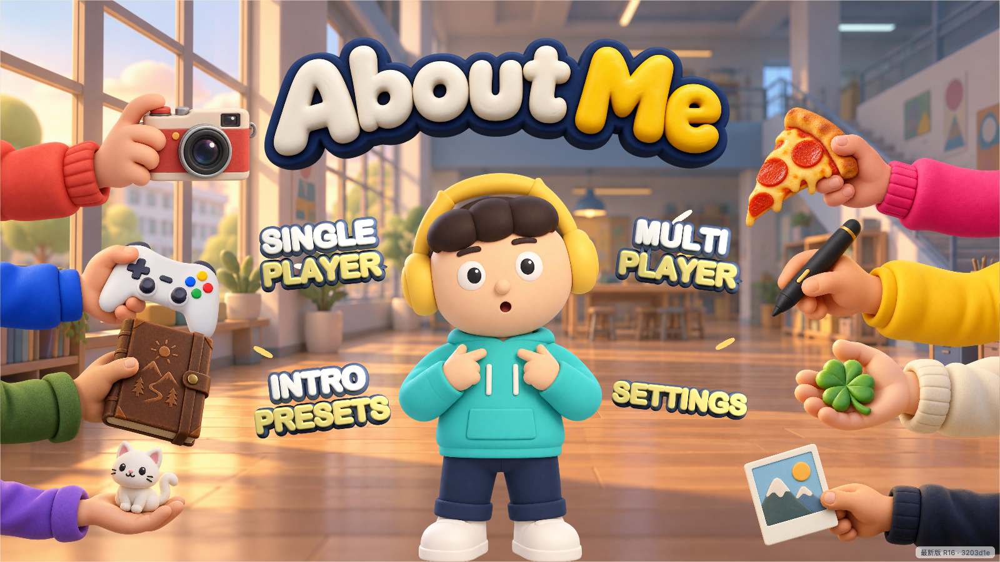
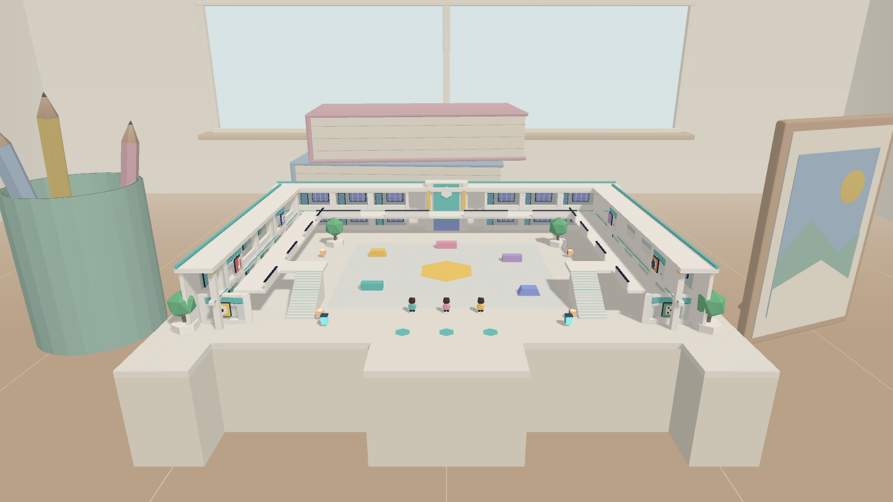
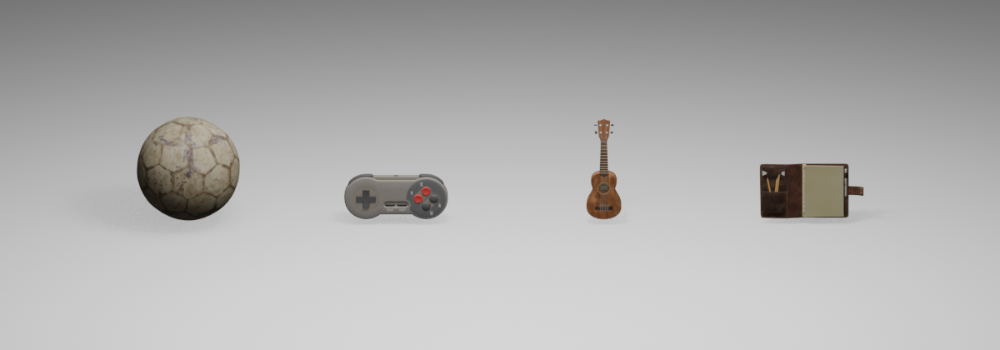
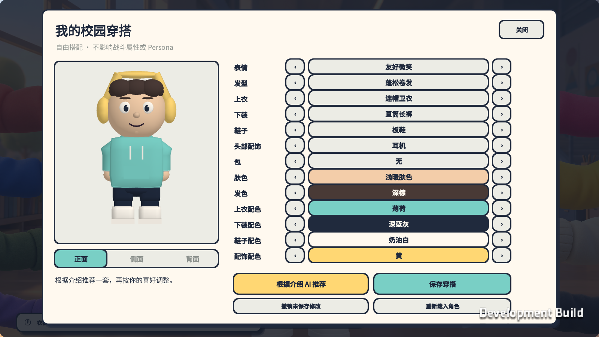

<div align="center">

# About Me

**把「我是谁」，变成一场玩具派对。**

A self-introduction becomes your inventory. Your inventory becomes the game.

[](https://github.com/ztjklt/About-Me/actions/workflows/repository-checks.yml)


**[浏览器试玩 ↗](https://web-production-fb9b1.up.railway.app/)** · [English](README.en.md) · [开发指南](docs/DEVELOPMENT.md) · [架构](docs/ARCHITECTURE.md)



</div>

**About Me** 是一款 3D Persona 派对对战游戏原型。写下兴趣、学校和性格，AI 会把介绍中可定位的内容变成可装备的道具：篮球、相机、校徽飞盘，或立体性格词条。在桌面上的微缩校园里，拿它们投掷、抓取、争抢和吞噬，直到产生最后的赢家。

项目已经串起 **自我介绍 → Persona 生成与保存 → 单人练习 / 多人房间 → 战斗 → 结算与重玩**。当前公开展示基线为 **R16**，支持 macOS 和 WebGL 客户端、Linux 权威游戏服务及 Python API。

## 先玩一局

打开 **[在线试玩](https://web-production-fb9b1.up.railway.app/)**，选择 **Single Player → 使用练习道具开始（非 AI）**，即可先体验核心玩法，无需填写 API key。单人可搭配 1–6 名人机；多人房间支持 2–6 人。

在 **Intro Presets** 中可以编辑介绍并生成自己的 Persona。真实生成依赖演示服务器的模型配置和可用额度；服务不可用时会明确提示。练习道具始终是标注过的固定样例。

> 浏览器试玩需要加载 WebGL 资源，首次打开请稍候。建议先用桌面浏览器体验；移动端有横屏触控，微信真机仍待验收。

## 游戏里有什么

| 体验 | 设计与实现 |
| --- | --- |
| **介绍就是装备** | 从原文事实生成 Persona；每人最多 20 件，可保存、装备并编入五格快捷栏。 |
| **软身体派对对战** | 投掷、击倒、抓人、拉扯道具、持续挣脱；吞噬或回收需要时间，也会被攻击打断。 |
| **每局都在争夺身份** | 掉落仍归原主人，完成吞噬才转移计数；淘汰后观战，结束后查看结果并重玩。 |
| **有个性的道具库** | R16 交付包含 277 项道具、16 型 MBTI、性格与心情词条、四类动物表现。 |
| **桌面上的小校园** | 双层场地、公共道具与机关，以及定时进入场地的「大手点名」。 |
| **一起玩，也能独自练习** | 单人 NPC 与玩家共用战斗规则；多人使用权威服务器、WebSocket 同步和身份重连。 |

标准对局先展示 5 秒；第 2:30 和 5:00 触发大手点名，第 7:30 到时结算。只剩一名存活者时可提前结束；到时先比较吞噬数，再比较剩余 Persona。

## 画面与界面

<table>
  <tr>
    <td width="50%"><br><b>桌面微缩校园</b><br>场景专项的引擎截图。</td>
    <td width="50%"><br><b>可拿在手里的 Persona</b><br>已导入工程的 CC0 道具预览。</td>
  </tr>
  <tr>
    <td><br><b>随身 Persona 背包</b><br>装备、分类与五格快捷栏。</td>
    <td><br><b>介绍与角色表达</b><br>配色、造型和角色外观。</td>
  </tr>
</table>

主菜单为 R16 留存截图；画廊保留了场景、CC0 道具和界面设计的开发预览。背包使用固定预览数据，不连接服务器；历史界面数值不代表 R16 的容量配置。实测范围见 [R16 交付记录](docs/INPUT_R16_DELIVERY.md)。

## 操作

| 操作 | 键位 |
| --- | --- |
| 移动 / 奔跑 | `WASD` / 双击方向键 |
| 观察 / 跳跃 | 鼠标 / `Space` |
| 使用当前道具 / 抛出公共道具 | `F` |
| 抓人 / 抓对手的道具 | `G` / `H` |
| 拾取、吞噬或回收 | `E` |
| 持续挣脱 / 取消交互 | 按住 `Q` / `Q` |
| 切换道具 / 背包 | `1`–`5` / `B` |
| 观战切换 / 释放光标 | `Tab` / `Esc` |

## 从源码打开

```sh
git clone https://github.com/ztjklt/About-Me.git
cd About-Me
```

在 **团结 Hub** 中添加 `client/`，使用 **2022.3.62t11**，打开 `Assets/AboutMe/Scenes/Bootstrap.unity` 后点击 Play。单人练习可直接体验；AI 生成与多人联机的服务配置见 [开发指南](docs/DEVELOPMENT.md)。

仓库包含源码与游戏资源。预编译包、本机账号数据和凭据不随仓库发布；`scripts/start-latest.command` 是已有 R16 整合包的本机入口，首次克隆需先按开发指南构建。

## 技术与源码导航

| 目录 | 内容 |
| --- | --- |
| [`client/Assets/AboutMe/Runtime`](client/Assets/AboutMe/Runtime) | C# 战斗规则、软身体表现、网络同步、UI 与平台桥接 |
| [`client/Assets/AboutMe/Editor`](client/Assets/AboutMe/Editor) | 场景生成、规则测试和多平台构建入口 |
| [`server`](server) | FastAPI、SQLite、账号、AI 生成与识别、校徽和调侃接口 |
| [`shared`](shared) | 受控道具目录、机制、外观与词条契约 |
| [`deploy`](deploy) | Docker、Caddy、HTTPS/WSS 与 Railway 发布辅助工具 |

Persona 生成采用受控目录与数据校验；原始自我介绍留在本人鉴权资料和服务端，公开对局投影只包含玩法所需的道具字段。模型与游戏服务密钥只通过服务端环境变量配置。

## 项目状态与更多文档

R16 的历史交付记录包含 Mac / WebGL / Linux 构建、后端回归及公网自动联机检查。本次公开整理另行重跑 **538 项后端测试**，并核对密钥与 Git 历史；这不替代真人对战平衡、两地网络或微信真机验收。

- [开发与构建](docs/DEVELOPMENT.md) · [部署](docs/DEPLOYMENT.md) · [架构](docs/ARCHITECTURE.md)
- [产品设计](docs/PRD.md) · [开发状态与历史验收](docs/STATUS.md) · [R16 交付](docs/INPUT_R16_DELIVERY.md)
- [公开仓库检查记录](docs/PUBLIC_REPOSITORY_AUDIT.md) · [安全与凭据](SECURITY.md) · [贡献指南](CONTRIBUTING.md)
- [第三方资源来源](docs/THIRD_PARTY_PERSONA_ASSETS.md)

本仓库用于作品展示与技术交流，目前没有为整个工程授予统一的开源许可证。Mirror、字体和第三方模型保留各自的许可与来源；品牌角色、校徽及其他标识请按对应来源的要求使用。
