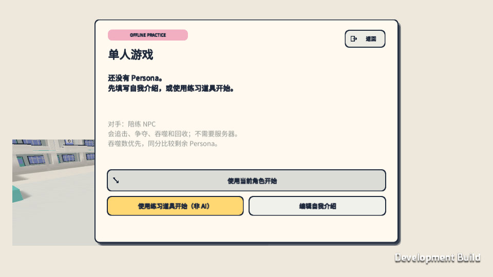
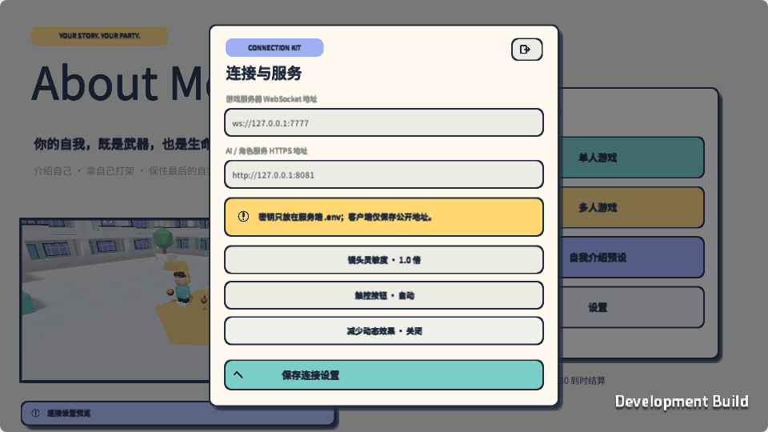
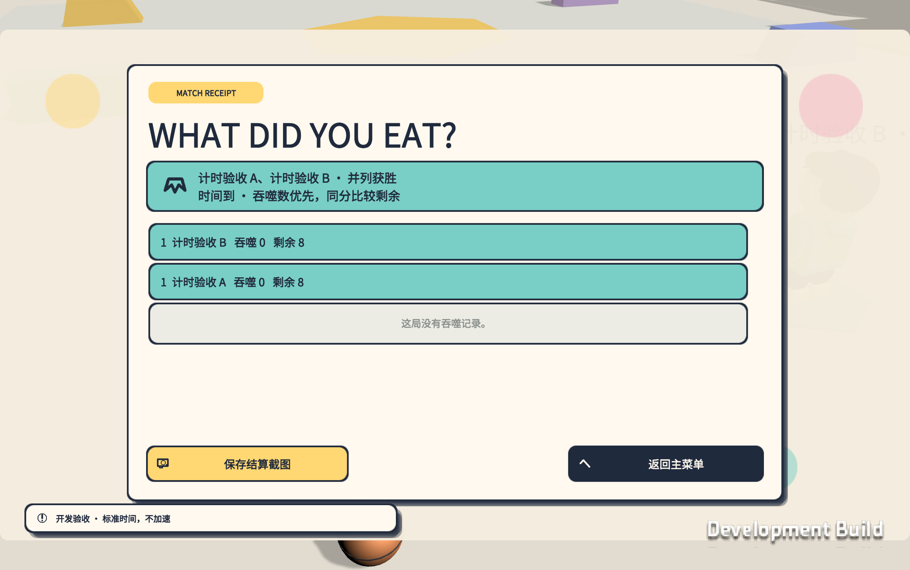
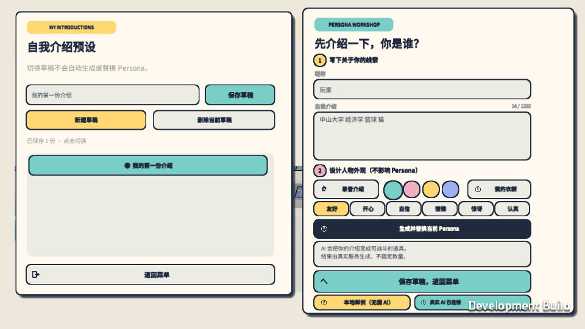

# 菜单、单人 NPC 与大手交付

更新：2026-09-23；团结引擎 2022.3.62t11。

## 体验入口

直接打开 `builds/mac/About Me.app`，选择「单人游戏 → 使用练习道具开始（非 AI）」。此路径不依赖 API、AI、游戏服务器或其他玩家。使用当前角色开始则使用已缓存的 Persona。练习资产与真实生成明确区分。

需要 AI 或多人房间时运行 `scripts/start-local.command`。菜单包含：

- 单人游戏：当前角色、明确的练习角色、NPC 对战与结算重玩。
- 多人游戏：创建房间、输入六位码加入；2–6 人，两人即可由房主开始。
- 自我介绍预设：多份命名草稿、新建、保存、切换和删除。仅有一套当前 Persona；切换草稿不会触发 AI 或替换资产。生成成功才替换当前 Persona。
- 设置：服务地址、镜头灵敏度、触控自动 / 显示 / 隐藏、减少动态效果。

## 规则与行为

5 秒不可争夺的展示后，战斗第 2:30、5:00 发生大手，第 7:30 强制结算，不触发第三次大手或 Final Burst。只有一名存活者时提前结束。到时仅存活者可获胜，先比已完成吞噬，再比剩余 Persona，同分同余量并列获胜。地面、手持及吞噬未完成的资产仍属原主人；到时未完成的交互取消，不补计吞噬。

NPC 看自己的公开快照与背包，使用同样的攻击、蓄力、抓取和交互规则。它会追击玩家，争夺地面道具，在仅余一个 Persona 时优先回收；沿校园楼梯可追上二层，卡住时重新寻路。它是规则控制的练习对手，不调用语言模型。

大手使用权威事件 ID 和时间戳连续播放预警、接近、0.65 秒接触、短暂停留、平滑退场。伤害与掉落仍由 Match 处理；减少动态效果关闭倾斜和镜头震动。

## 验证与证据

- 最终 WebGL 构建复验：使用已保存的「中山大学校徽圆盘」进入单人局，NPC 完成追击、掉落、吞噬并淘汰玩家，结算显示吞噬 1、剩余 1；离线局不显示重连入口。
- 实际 WebGL 操作：关闭 API 与游戏服务，从主菜单启动练习局，NPC 追击、攻击、吞噬并赢下完整一局；重玩重新生成本局实例。
- 新版网页用真实已保存角色创建房间成功，确认身份验证接通；关闭房间后可进入单人局。网页控制台检查没有 error 记录。
- 实际网页预设操作：新建中文草稿，填写中文介绍，保存、重载恢复、删除测试草稿并恢复原草稿。原生中文输入法切换仍建议用户用自己的输入法复验。
- 规则测试：标准计时、并列 / 排名 / 淘汰资格、边界交互取消、重玩唯一实例、NPC 攻击与回收、实际走上二层、路径、手势连续性。
- 六人同时连接发现共享 SHA1 导致握手失败，已对 Mirror 的 CreateHash 加锁；新增 512 次并发哈希校验，并重新进行 2 / 4 / 6 独立客户端 WebSocket 回归。它们是本机、加速测试，不代表公网或真机验收。
- API 新增并列胜者、排名、结算原因持久化，以及重复 matchId 不覆盖首次结果的验证；兼容旧结果格式。
- 标准时间验收未使用 `--accelerated`：5 秒展示 + 450 秒战斗，第 150.0163 / 300.0109 秒触发大手，450 秒结算，两个静止角色并列。墙钟总耗时 463.6 秒（同时构建与多进程测试产生卡顿），该记录不能当作性能承诺或真人完整比赛。
- 界面截图覆盖 1600×900、1280×720、960×540、19.5:9 与 4:3；修复标题裁切、设置预览层级、主菜单 3D 窗口比例、快捷栏长名称及单人重连入口。

证据目录：`artifacts/menu-audit`、`artifacts/network-2`、`artifacts/network-4`、`artifacts/network-6`，构建日志在 `artifacts/BuildMac.log`、`BuildWeb.log`、`BuildServer.log`。

## 复现

```sh
sh scripts/editor.sh TestRules
.venv/bin/python -m pytest server/tests -q
.venv/bin/python scripts/test-network.py --players 6 --port 7796
'builds/mac/About Me.app/Contents/MacOS/About Me' --ui-preview settings --capture-size 960x540 --capture "$PWD/artifacts/settings.png"
'builds/mac/About Me.app/Contents/MacOS/About Me' --schedule-audit --audit-output "$PWD/artifacts/menu-audit" -logFile "$PWD/artifacts/menu-audit/schedule.log"
```

`--ui-preview` 额外支持 home / solo / multiplayer / presets。计时验收是独立开发入口，正常菜单不会启用。

## 边界

公网部署、微信 AppID / 真机、真实 ASR 仍未验收。Linux 服务端仅构建验证，未在 Linux 主机运行。NPC 已能实战，但难度与多人平衡仍是原型水平。结算截图在本机保存；离线单人结果不上传服务器。

## 运行截图









